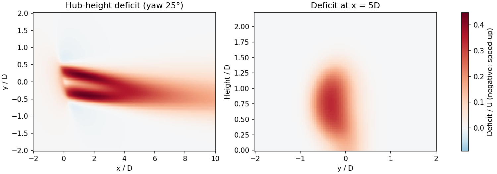

# WakeMarch

[](https://pypi.org/project/wakemarch/)
[](https://doi.org/10.5281/zenodo.23888293)

WakeMarch is a steady, cross-plane marching wake model for a single yawed wind
turbine. It resolves the curled (kidney-shaped) wake produced by the
counter-rotating streamwise vortex pair of a yawed rotor, in uniform or
power-law-sheared inflow, and returns the wake deficit, streamwise vorticity and
velocity anywhere downstream.

The core depends only on NumPy (≥ 1.24) and SciPy (≥ 1.10) and needs
Python 3.11 or later. The upper bounds `<3`/`<2` are compatibility boundaries,
not evidence of tests on every release.



Start with the [user guide](https://github.com/haibuihoang/wakemarch/blob/main/docs/USER_GUIDE.md), then the
[API notebook](https://github.com/haibuihoang/wakemarch/blob/main/examples/wakemarch_api_test.ipynb) and
[resolution/cost notebook](https://github.com/haibuihoang/wakemarch/blob/main/examples/wakemarch_performance.ipynb).
[Turbine curves and presets](https://github.com/haibuihoang/wakemarch/blob/main/docs/TURBINES.md) and an
[interactive turbine notebook](https://github.com/haibuihoang/wakemarch/blob/main/examples/wakemarch_turbines.ipynb) accept user CP/CT
or power/CT tables, including rotor-wide velocity samples.
An optional [PIV comparison](https://github.com/haibuihoang/wakemarch/blob/main/examples/wakemarch_piv_validation.ipynb) uses a
separately downloaded public dataset and discloses inherited calibration.
Read [scientific scope](https://github.com/haibuihoang/wakemarch/blob/main/docs/SCIENCE.md) and [citation](https://github.com/haibuihoang/wakemarch/blob/main/CITATION.md) before
using results in research. The figure is generated by `examples/plot_wake.py`.

## Install and run

```sh
python -m pip install wakemarch
```

Or, from a source checkout (the directory containing `pyproject.toml`):

```sh
python -m pip install .
python -I examples/first_wake.py
python -I tests/test_api.py
```

### Jupyter notebooks

The interactive entry point is `examples/wakemarch_api_test.ipynb`. It contains
editable inputs, live progress, hub-height/cross-plane plots, yaw comparisons,
and executable API checks. Run every cell with a fresh kernel.

```sh
python -m pip install 'wakemarch[notebooks]'      # or '.[notebooks]' from source
python -m jupyterlab examples/wakemarch_api_test.ipynb
```

No measurement data, FLORIS, plotting or Jupyter are needed for the core example
or tests. For verifying built artifacts, see [release checks](https://github.com/haibuihoang/wakemarch/blob/main/docs/RELEASING.md).

```python
from wakemarch import Numerics, WakeModel

model = WakeModel(
    D=126, H=90, U=8, CT=0.8, yaw_deg=25, TI=0.06,
    numerics=Numerics(h_D=1 / 20),
)
result = model.solve(max_dist_D=10)
deficit = result.sample_deficit(x=5 * 126, y=0, z=90)
velocity = result.sample_streamwise_velocity(x=5 * 126, y=0, z=90)
v, w = result.sample_cross_velocity(x=5 * 126, y=0, z=90)  # lateral, vertical
print(deficit, velocity, v, w)  # m/s
```

Progress is enabled by default. Jupyter uses a native HTML progress bar (no widget
extension needed); terminals use a text bar. `model.solve(progress=False)` is
silent. A callable such as `progress=lambda completed_D, total_D: ...` receives
an initial zero and updates after each marching step. Total distance includes
the reconstruction buffer. The display closes on success, errors and interrupts;
callback exceptions propagate. Progress observes the solve without changing its
numerical operations. It measures downstream advancement, not a guaranteed time
remaining estimate.

## Define turbine performance once

```python
from wakemarch import Turbine, Numerics

turbine = Turbine.preset("nrel_5MW")
point = turbine.operating_point([6.0, 10.0], yaw_deg=20)
print(point.power_W, point.CT)
model = turbine.wake_model([6.0, 10.0], yaw_deg=20, TI=0.1,
                           numerics=Numerics(h_D=0.1))
```

Use `Turbine.from_cp_ct(...)` or `Turbine.from_power_ct(...)` for your own curves,
or `Turbine.fixed(...)` for constant coefficients. See
[units, efficiency, averaging and table limits](https://github.com/haibuihoang/wakemarch/blob/main/docs/TURBINES.md). The scalar-CT
`WakeModel` API does not require a power curve.

## Conventions and API

- Physical inputs: `D`, `H` in metres (H ≥ D/2); `U` in m/s; `CT` is the
  **unyawed** thrust coefficient; `TI` is a fraction, e.g. 0.06, not 6; yaw is in
  degrees, |yaw| ≤ 50 (validated to 40).
- Positive yaw deflects towards negative `y`. `x` is downstream from the turbine,
  `y` is lateral from its centre, and sampled `z` is height above ground.
- `Numerics` groups grid and stepping choices. Defaults are grid D/30, lateral
  width 8D, top 3.5D **above hub**, dx=0.1D, requested storage interval=0.25D.
  There is no automatic coarsening. Ground and open boundaries are enabled.
- `WakeModel` (0.3): thrust law `T_x = T_x0 cos^2(yaw)` (or a measured
  `thrust_ratio`), circulation `4 F_y / (pi rho D U)`, initial deficit of the unyawed
  wake projected on the stream, momentum fraction 0.95, eddy viscosity
  `cos^2(yaw) k_w sigma u_bar F(x/x0)` delayed over the near-wake length
  (`F = 1 - (1 - 2 xi^2) exp(-xi^2)`), vortex diffusivity 0.25 of the eddy viscosity, hub deficit and
  edge thickness of an actuator disk without nacelle, and the near field of the rotor
  displayed as the actuator-disk vortex cylinder (no constant).
- Wake rotation: give the rotor torque coefficient `CQ = Q/(0.5 rho pi R^3 U^2)`
  (or `C_P / tip-speed ratio`) and `rotor_sense` (`"clockwise"` by default, seen
  from upstream). It sets the lateral offset of the unyawed wake and the asymmetry
  between positive and negative yaw. `CQ=None` omits the rotation.
- `hub_depth` (default 0.6) is the depth of the hub deficit of the initial wake, fitted
  on an LES actuator disk without nacelle; use a smaller value or 0 for a rotor with a nacelle.
- Switches for comparisons and sensitivity tests: `hub_depth=0` (no hub hole),
  `near_field=False` (developed wake from the rotor plane, no near-field display),
  `domain_area=A` (blockage of a confined domain of cross-section A in m^2, e.g. an LES
  domain or a closed wind tunnel; default None, open atmosphere), `CQ=None` (no rotation).
- `solve()` returns an independent `WakeResult`; solving again never changes a
  previous result. Inputs/settings are immutable dataclasses.
- Sampling accepts scalars or broadcastable arrays. `sample_deficit` includes
  reconstruction and the near-field display; `sample_streamwise_velocity` subtracts
  this from the same power-law background used by the model.
  `sample_cross_velocity` returns the cross-plane velocities `(v, w)` (lateral,
  vertical): the total in-plane flow the solver uses to transport the wake
  (vortex-induced plus entrainment), without the near-field display.
- Upstream of the tilted rotor (`x + y*tan(yaw) < 0`) the deficit is the induction
  zone of the rotor (zero with `near_field=False`). Outside
  downstream stored support the default is an error. `bounds="zero"` explicitly
  requests a zero-deficit extension (background streamwise velocity).
  Nonfinite coordinates and negative heights raise errors.
- `result.x` is the stored **marching** coordinate x_s, not global x on a yawed
  cross-plane. `result.z` is absolute height; `z_relative` is relative to hub.
  `marching_deficit`, `streamwise_vorticity`, and
  `streamwise_velocity_derivative` have axes `(x_s, z_relative, y)` and units m/s,
  1/s and 1/s. They are read-only views; the histories do not include the near-field
  display. Use the sampling methods for physical-space visualizations.

The kernel marches an extra yaw-dependent distance for reconstruction. With
dx=0.1D, requested storage 0.25D stores at 0.3D spacing (storage happens on
marching steps). Sampling uses actual stored support, not the nominal requested
distance.

## Scientific scope

This is a steady engineering model of one turbine in uniform or power-law-sheared
inflow, not an active downstream-turbine or farm solver. Input bounds are numerical
guards, not claims of validation over their entire range. It does not resolve
ground-boundary-layer dynamics or wake pressure gradients. It has known near-wake,
high-TI and high-yaw/far-wake limitations.

The vorticity advection construction is approximately conservative; the full
variable-coefficient diffusion equation does not establish exact circulation
conservation. Force-based initialization does not imply exact agreement of the
discrete vortex integral with its target. Better empirical predictions are not
proof of exact force or conservation consistency. Validation evidence is in the
accompanying paper; installing the package does not add new observational
validation.

Optional dependency groups: `[plot]`, `[notebooks]`, `[validation]`. They are
conveniences for documentation and data workflows, not required by the core.
Measurement and simulation datasets are not distributed with the package; each
keeps its own licence and access terms.

## Development and provenance

See [provenance](https://github.com/haibuihoang/wakemarch/blob/main/PROVENANCE.md). `wakemarch._kernel` is private and
not a supported public interface. The march reproduces the authors' research
solver on eight cases to a relative difference of 1.5e-9
(`tools/check_release.py` runs the portable checks).

## Licence

BSD 3-Clause; see [LICENSE](https://github.com/haibuihoang/wakemarch/blob/main/LICENSE). The bundled reference turbine tables come
from FLORIS 4.6.2 and keep their own BSD 3-Clause licence
(`src/wakemarch/data/FLORIS_LICENSE.txt`).
